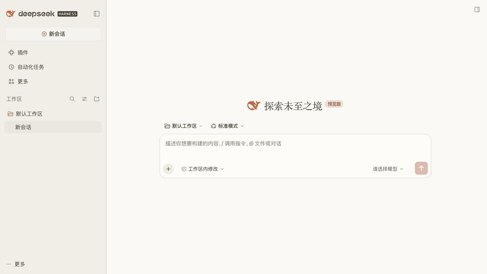
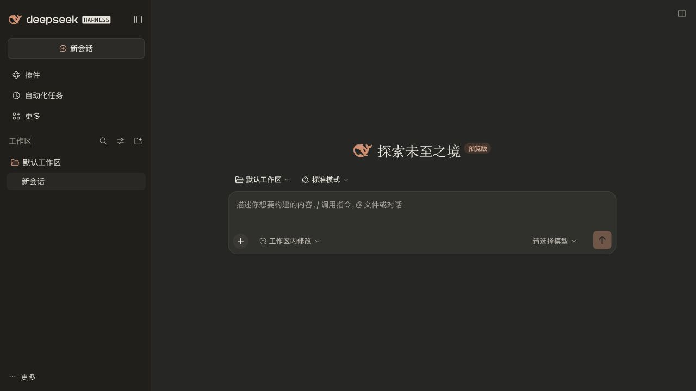

# dsh-skin-claude

给 DeepSeek Harness 换上 Claude 风格外观与 Anthropic Sans / Serif 字体。

**皮肤 v0.2.0 · 最新实测 DSH：`0.2.1-rc.5`**

[下载安装包](releases/dsh-skin-claude-0.2.0.zip) · [字体说明](docs/fonts.md) · [本版验证](qa/v0.2.0/runtime.json)

米白画布、暖灰侧栏、陶土橙强调色、柔和圆角输入框。界面使用 Anthropic Sans，欢迎标题和回答正文使用 Anthropic Serif；深色模式使用暖炭灰。跟随 DSH 的浅色、深色和系统外观设置。




## 本机加载 Claude 原字体

仓库不包含 Anthropic 字体二进制文件。已安装 Claude macOS 应用时，运行：

```sh
npm run build:local
```

脚本从 `/Applications/Claude.app/Contents/Resources/fonts` 读取四个原始可变字体，生成 `local-installations/dsh-skin-claude-0.2.0`。在 DSH **插件 → 添加插件** 中填写该目录的绝对路径，安装并启用。需要 Node.js 20+，没有第三方依赖，无需 `npm install`。

其他本地字体目录也可传入：

```sh
npm run build:local -- /absolute/path/to/claude/fonts
```

这个本地包内嵌字体供本机使用，已被 Git 忽略；请保留该目录，不要将它上传为仓库发行包。它不修改系统字体或 Claude 应用文件。

## 普通安装

1. 下载上方 ZIP，解压到一个长期保留的位置。
2. 在 DSH **插件 → 添加插件** 中填写解压后 `dsh-skin-claude-0.2.0` 文件夹的绝对路径。
3. 安装后启用 **dsh-skin-claude**。
4. 在 **设置 → 外观** 中选择浅色、深色或跟随系统。

也可以克隆仓库，直接安装仓库根目录。`lib/` 已生成，普通安装无需构建。

普通发行包通过 `local()` 使用系统已安装的 Anthropic 字体，没有这些字体时自动回退。要使用本机 Claude 应用自带的完整字体，请按上节生成本地包。

已有其他皮肤时先停用其他皮肤，再启用本插件。安装目录需要持续保留，DSH 会从该目录加载插件。升级后完整退出并重新打开 DSH，以刷新客户端模块缓存。

## 外观与字体

| 部位 | 浅色 | 深色 |
| --- | --- | --- |
| 主背景 | `#FAF9F5` | `#262624` |
| 侧栏 | `#F0EEE6` | `#201F1C` |
| 输入框 | `#FDFCF9` | `#30302D` |
| 强调色 | `#C96442` | `#D98C6E` |
| 正文 | `#3D3929` | `#E8E6DC` |

103 组深浅主题变量包含字体分工。Sans / Serif 均提供正常和斜体字面，使用原字体的 300–800 字重范围。原字体未覆盖的中文字符使用系统回退；代码与终端继续使用 DSH 的等宽字体。字号、布局规则、快捷键、窗口拖动、发送与停止逻辑保留，字形宽度随所选字体自然变化。错误、警告、成功与文件差异颜色仍由 DSH 管理。

插件没有运行依赖、网络请求、远程字体或会话数据访问。普通客户端约 17 KiB；本地完整字体包较大，因为直接内嵌原字体数据。

## 验证

2026-11-02 在本机 DSH `0.2.1-rc.5` 完成隔离 Web 客户端验证和原生桌面安装、启用及完整重启验证。

- 本地包内嵌的四个字体逐字节匹配本机 Claude 原文件。
- 实际加载的 CSS、Sans / Serif 字体变量与本地构建匹配。
- 深浅主题、中文与英文输入/删除、停用恢复和刷新通过。
- 10 项自动测试通过，覆盖 100 次启停、重复加载、失败回退、样式作用域、字体引用及关键文字对比度。
- GitHub 只包含字体加载代码和无字体二进制的发行包。

本版不再沿用 v0.1.0 的控件像素一致结论，因为字体变化会影响文字宽度。没有向模型发送测试消息，实际模型回答、终端输出及其他第三方插件的所有组合未覆盖。原生桌面截图仅保存在本机，仓库预览来自隔离实例。

## 开发

```sh
npm run build
npm run check
npm test
npm run pack:skin
```

打包 ZIP 另需 Python 3。标准构建不会读取本机 Claude 字体，`build:local` 才生成含原字体的本地包。

| 文件 | 用途 |
| --- | --- |
| `src/tokens.json` | 成对的主题颜色与字体变量 |
| `src/claude.css` | 局部外观规则 |
| `src/client.template.js` | 加载、清理与失败回退 |
| `scripts/fonts.mjs` | 原字体的名称、字重与正常/斜体引用 |
| `scripts/build-local.mjs` | 读取本机原字体，生成本地安装目录 |
| `lib/` | 可直接安装的普通发行入口 |
| `qa/v0.2.0/` | 本版隔离实例预览和验证记录 |

GitHub Actions 自动检查提交的 `lib/` 与源码是否一致，并运行测试。发行 ZIP 带固定时间及 SHA-256 清单；同版本的不同内容不能覆盖。宿主升级后需重新验证接口和 CSS 模块类名。

## 停用

关闭 **插件 → dsh-skin-claude** 开关即可恢复 DSH 原生外观与字体。插件停用时撤销自己的主题覆盖层、样式节点和标记。

代码使用 MIT License。Anthropic 字体文件不在该许可证或本仓库分发范围内。这是 Claude 风格的第三方主题，与 Anthropic、Claude 或 DeepSeek 官方无隶属关系。
