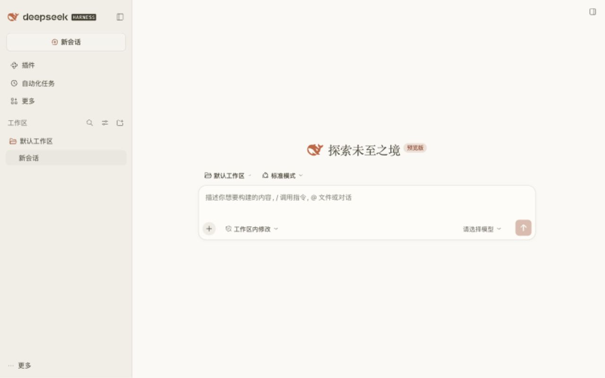
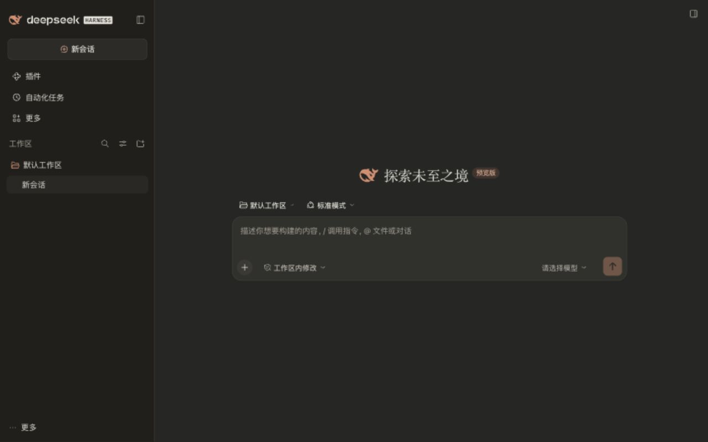

# dsh-skin-claude

给 DeepSeek Harness 换上一层 Claude 风格的暖纸色外观。

**皮肤 v0.1.0 · 最新实测 DSH：`0.2.1-rc.5`**

[下载安装包](releases/dsh-skin-claude-0.1.0.zip) · [验证记录](qa/v0.1.0/runtime.json) · [文件校验](releases/dsh-skin-claude-0.1.0.sha256.json)

米白画布、暖灰侧栏、陶土橙强调色、柔和圆角输入框，以及带衬线的欢迎标题。深色模式使用暖炭灰。跟随 DSH 的浅色、深色和系统外观设置。




## 安装

1. 下载上方 ZIP，解压到一个长期保留的位置。
2. 在 DSH **插件 → 添加插件** 中填写解压后 `dsh-skin-claude-0.1.0` 文件夹的绝对路径。
3. 安装后启用 **dsh-skin-claude**。
4. 在 **设置 → 外观** 中选择浅色、深色或跟随系统。

也可以克隆本仓库，直接把仓库根目录的绝对路径交给插件管理器。仓库已包含生成后的 `lib/`，安装无需 Node.js 或构建步骤。

已有其他皮肤时，先停用其他皮肤，再启用本插件，避免多个主题覆盖层竞争。安装目录需要持续保留，因为 DSH 会从该目录加载插件。升级后完整退出并重新打开 DSH，以刷新客户端模块缓存。

## 外观

| 部位 | 浅色 | 深色 |
| --- | --- | --- |
| 主背景 | `#FAF9F5` | `#262624` |
| 侧栏 | `#F0EEE6` | `#201F1C` |
| 输入框 | `#FDFCF9` | `#30302D` |
| 强调色 | `#C96442` | `#D98C6E` |
| 正文 | `#3D3929` | `#E8E6DC` |

共覆盖 90 组 DSH 主题变量。正文、代码与终端沿用 DSH 及用户的字体设置；仅欢迎标题使用系统可用的衬线字体，用户指定正文字体时优先使用用户设置。原有布局、字号、快捷键、窗口拖动、发送与停止逻辑保留。错误、警告、成功与文件差异颜色由 DSH 继续管理。

插件没有运行依赖、网络请求、远程字体、启动遮罩、计时器或会话数据访问。生成的客户端约 13 KiB。

## 验证

2026-11-02 使用 macOS 本机安装的 DSH `0.2.1-rc.5` 启动**独立 Web profile**，通过真实客户端完成以下检查：

- 浅色、深色、跟随系统，刷新后的插件加载。
- 中文输入与删除，发送按钮随草稿状态变化。
- 主界面、设置页、插件页及 470 px 窄窗口。
- 在插件管理器停用、重新启用，确认样式与主题覆盖被清理。
- 同一滚动位置对比插件页 29 个控件，位置与尺寸一致。
- 实际加载的样式 SHA-256 与源码构建一致，浏览器警告与错误为 0。

9 项自动测试通过，包含 100 次启停、重复加载、异常回退、样式作用域，以及关键文本颜色的 4.5:1 对比度检查。详细范围见 [验证说明](docs/verification.md)。本次没有对个人桌面 profile 安装或替换皮肤，也没有向模型发送测试消息；原生窗口装饰、实际代码/终端输出和其他第三方插件组合未单独验证。

## 开发

需要 Node.js 20+；打包 ZIP 另需 Python 3。没有第三方依赖，无需 `npm install`。

```sh
npm run build
npm run check
npm test
npm run pack:skin
```

| 文件 | 用途 |
| --- | --- |
| `src/tokens.json` | 成对的浅色 / 深色主题变量 |
| `src/claude.css` | 版本绑定的局部外观规则 |
| `src/client.template.js` | 插件加载、清理与失败回退 |
| `cordis.patch.yml` | DSH 组合入口 |
| `lib/` | 已生成的可安装入口 |
| `docs/host-contract.json` | 实测宿主版本、变量与接口依据 |
| `qa/v0.1.0/` | 隔离实例预览与验证证据 |

构建不会安装或启用插件。`npm run check` 检查提交的 `lib/` 是否与源码一致；GitHub Actions 会自动执行检查和测试。发行 ZIP 有固定文件时间和 SHA-256 清单；打包脚本拒绝覆盖内容不同的同版本包，修改后应递增版本。宿主升级时需重新核对主题接口、CSS 模块类名和真实界面，不能只修改 `engines.dsh`。

## 停用

关闭 **插件 → dsh-skin-claude** 开关即可恢复 DSH 原生外观。插件通过 DSH 的 `theme.overrideTokens` 注册自己的覆盖层，停用时同时撤销覆盖、样式节点和标记。

MIT License。Claude 风格的第三方主题，与 Anthropic、Claude 或 DeepSeek 官方无隶属关系；未包含 Claude 商标图像、专有字体或产品源码。
